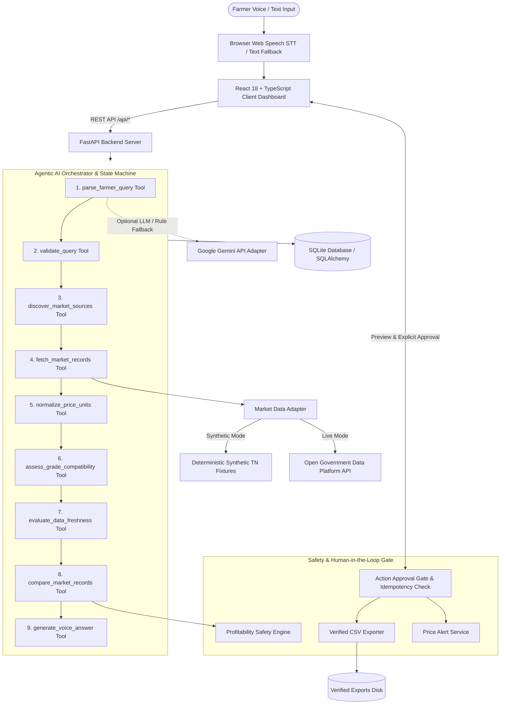
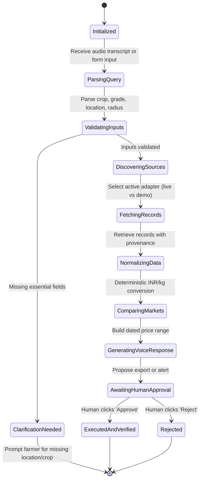
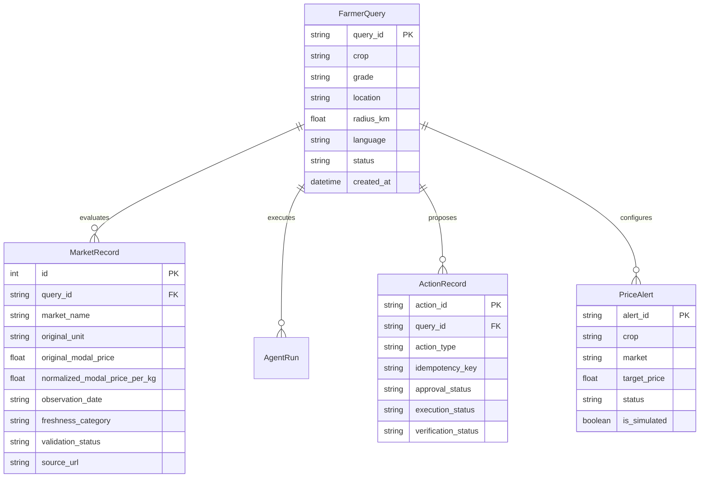

# Farmer Mandi Price Voice Agent — System Architecture

**Hackathon Category:** Social Impact & Sustainability AI  
**Event:** Agentic AI Hackathon 2026 — Powered by Ziro.Digital  
**Author:** AI Engineering & Architecture Team  

---

## 1. Executive Architecture Overview

The **Farmer Mandi Price Voice Agent** is a multi-tier agentic AI system designed to empower Indian farmers with verified, dated agricultural market prices, transparent unit normalizations (INR/quintal and INR/tonne to INR/kg), bilingual voice interaction (English and Tamil), and strict economic safety guardrails.

---

## 2. Multi-Step Agent State Machine

The agent transitions through discrete states, preserving execution provenance in the `AgentRun` table:

---

## 3. The LLM vs. Deterministic Boundary

To prevent hallucinations in agricultural commerce, the architecture strictly segregates natural language understanding from critical business logic:

| Function | Execution Method | Justification |
| :--- | :--- | :--- |
| **Natural Language Parsing** | Gemini API + Rule-Based Regex Fallback | Handles linguistic diversity across English and Tamil dialect terms. |
| **Unit Normalization** | Deterministic Python arithmetic | Arithmetic errors can cause devastating financial loss to a smallholder farmer. |
| **Date Freshness Evaluation** | Deterministic calendar comparison | Distinguishes current trading from yesterday's data without hallucinated timestamps. |
| **Grade Compatibility** | Deterministic lookup table | Ensures Grade A is never silently matched with Grade C / Damaged produce. |
| **Profitability Calculation** | Deterministic safety rule | Enforces mandatory rule: never claim "most profitable" when transport cost is unknown. |
| **Action Execution & Verification** | Idempotency key + File verification | Prevents duplicate exports or unverified alert registrations. |

---

## 4. Unit Conversion & Normalization Rules

Prices across Indian mandis are reported in diverse regional and statutory units:
- **1 Quintal = 100 Kilograms**
- **1 Metric Tonne = 1,000 Kilograms**
- Conversion formula:
  $$\text{Price (INR/kg)} = \frac{\text{Reported Price (INR/unit)}}{\text{Kilograms per unit}}$$

Examples:
- ₹2,200 per quintal $\div 100 = \text{₹}22.00\text{ per kg}$
- ₹24,000 per metric tonne $\div 1,000 = \text{₹}24.00\text{ per kg}$
- If unit is unverified or unknown (e.g. "bags", "crates"), the agent refuses to guess and excludes the record with an explicit explanation.

---

## 5. Profitability Safety Mechanism

A standard naive AI will often look at three markets (₹20, ₹22, ₹24) and declare the ₹24 market "the best profit". This is financially dangerous for a smallholder farmer: if the ₹24 market is 50 km away, transport costs will eliminate the ₹4/kg margin.

**Enforced Safety Policy:**
When transport costs are unknown or omitted:
> *"Transport cost is unknown. The most profitable market cannot be determined from price alone."*

When complete expenses are supplied by the farmer:
$$\text{Net Proceeds} = (\text{Selling Price} \times \text{Quantity}) - (\text{Transport} + \text{Loading} + \text{Market Fees} + \text{Packaging})$$

---

## 6. Database Schema (Entity-Relationship)

---

## 7. Security and Privacy Safeguards

1. **Zero Secret Leakage:** No API keys or tokens are sent to or stored in frontend bundles.
2. **Deterministic Offline Capability:** Works 100% out-of-the-box in synthetic demo mode without requiring paid API keys.
3. **Idempotency Safeguard:** All actions are tied to a unique `idempotency_key`. Repeated clicks or network retries return the verified state without creating duplicate entries.
4. **Audit Trail Persistence:** Every tool invocation, parameter, and post-execution verification is committed to SQLite for independent inspection.
